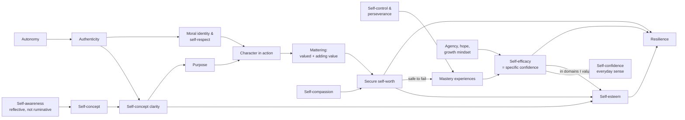

# Self-related outcomes: a map for Groundwork

**Date:** 1 November 2026
**Why this exists:** to decide which outcomes Groundwork aims at and measures. This document lists the candidates; it doesn't make the decision. For each one it gives:
- what the outcome is;
- how it relates to the others;
- what the research says about its effect on identity and character;
- where it sits in the app today.

**A note on terms.** These are usually called *self-constructs* or *self-beliefs*, not "self-care outcomes". In Australian health and wellbeing usage, "self-care" means looking after your physical and mental health (sleep, exercise, help-seeking). Using it here would mislead schools, and it's the clinical register you want the app to avoid. The working label in this document is **self outcomes**.

**Evidence labels used below:**
- **Strong:** meta-analyses or large longitudinal or randomised studies.
- **Moderate:** consistent studies, mostly correlational or small trials.
- **Weak / contested:** thin evidence, failed replications, or a construct that is in dispute.

---

## 1. The list at a glance

The list has 22 outcomes in seven families, plus one warning sign. Your four starters are marked ★.

| # | Outcome | One line | Family | Evidence for its effects | In the app now |
|---|---|---|---|---|---|
| 1 | Self-concept | The description of me | A. How I see myself | Strong | Taught (selves); built in Mission 1 |
| 2 | Self-concept clarity | How clear and consistent that description is | A | Strong | **Measured** (check-in) |
| 3 | Self-image | How I think I come across, including body image | A | Moderate | Taught (selves); Mission 4 Digital Self |
| 4 | Self-awareness | Noticing my own thoughts, feelings and patterns | A | Moderate; it depends on the type | The whole app; hard-on-self card |
| 5 | ★ Self-esteem | My overall evaluation of myself | B. How I judge myself | Strong (small effects) | Taught (selves) |
| 6 | Self-worth | Whether I count, regardless of results | B | Moderate | Taught (selves) |
| 7 | Self-acceptance | Accepting all of me, the good and the bad | B | Moderate | Implied only |
| 8 | Self-respect | Living by my own standards | B | Weak as a measured construct | Implied (The Standard, Character Code) |
| 9 | ★ Self-compassion | Treating myself kindly when things go wrong | C. How I treat myself | Moderate–strong | Compassion boost; hard-on-self card |
| 10 | ★ Self-efficacy | "I can do this specific thing" | D. What I believe I can do | Strong | Taught (incorrectly, see §3); week 5; boost |
| 11 | ★ Self-confidence | Feeling sure of myself, in everyday terms | D | Weak as a separate construct | Taught (selves); self-belief boost |
| 12 | Agency / locus of control | "What I do shapes what happens" | D | Moderate–strong | Implied (selves efficacy text) |
| 13 | Hope | Having goals, ways to reach them, and the will to use them | D | Moderate | Mission 4; Next Chapter; goals |
| 14 | Growth mindset | "Ability can grow" | D | Weak–moderate (small effects) | One example sentence |
| 15 | Self-control / self-regulation | Steering what I do in the moment | E. How I steer myself | Strong | Taught (selves); week 7 |
| 16 | Autonomy | Acting from reasons I endorse | E | Strong | Values Clarifier; overall design |
| 17 | Perseverance (grit) | Keeping going at hard things | E | Moderate; grit itself is contested | Week 5 |
| 18 | Authenticity | Being consistent with who I really am | F. Me among others | Moderate–strong | Mission 1 Mask Check; Mission 3 |
| 19 | Mattering | Feeling valued and adding value | F | Moderate | The Standard (unnamed) |
| 20 | Purpose | A lasting aim that matters to me and beyond me | F | Moderate–strong | Mission 2; **measured** |
| 21 | Moral identity | Being a good person is central to who I am | F | Moderate | Character Code; The Standard (unnamed) |
| 22 | Resilience | Doing well despite adversity | G. The overall result | Strong as a process | Resilience boost |
| ⚠ | Narcissism | Feeling superior and entitled to admiration | Warning sign | Strong | Avoided by design |

---

## 2. Each outcome in detail

### A. How I see myself

**1. Self-concept**
- **Definition:** the beliefs a person holds about their own attributes. It has many dimensions (academic, social, physical and more) and is organised in a hierarchy (Shavelson et al., 1976; Marsh).
- **Relationships:**
  - it is the "description" that self-esteem evaluates;
  - academic self-concept and achievement reinforce each other over time (Marsh's reciprocal-effects model; recently disputed by Sorjonen et al., 2024, and defended by Marsh and colleagues, 2025);
  - academic self-concept relates to achievement, but global self-esteem barely does.
- **Effect on identity and character:** self-concept is the content of identity. Interventions that target one domain and measure that domain work best: d = 1.16, against d = 0.51 overall (O'Mara et al., 2006).
- **In Groundwork:** well covered. Strengths, values and the mask check build it.
- **Gap:** domain self-concepts, i.e. "where am I building competence in the things I value?" (review §4 B1).

**2. Self-concept clarity**
- **Definition:** how clearly, confidently and consistently the self-concept is defined (Campbell et al., 1996).
- **Relationships:**
  - strongly correlated with self-esteem;
  - grows with identity commitment;
  - large gaps between the private and public self (authenticity) lower it.
- **Effect on identity and character:** it's the cleanest measure of whether identity work has "landed". The evidence plan notes it is very stable from year to year, so it may barely move in ten weeks.
- **In Groundwork:** already measured (check-in items c1–c3).
- **Role:** the bridge outcome between identity and esteem.

**3. Self-image**
- **Definition:** how a person pictures themselves and how they think they appear to others, including body image. (Rosenberg's 1965 work on adolescents used "self-image" broadly. The app's narrower meaning is the common modern usage.)
- **Relationships:** it is part of self-concept. Negative body image is consistently linked to low self-esteem in adolescents, especially girls.
- **Effect on identity and character:** a narrow input. It matters mainly as a source of distortion: harsh, outdated guesses about how you come across.
- **In Groundwork:** taught in the selves page and the Digital Self.
- **Role:** a vocabulary lens. Don't make it a target: it pulls toward appearance, and body image is clinical territory.

**4. Self-awareness**
- **Definition:** attention to one's own thoughts, feelings and patterns.
- **The key distinction:** there are two kinds.
  - **Reflection** is curious. It is linked to openness and better outcomes.
  - **Rumination** is anxious and repetitive. It is linked to distress (Trapnell & Campbell, 1999).
  - In identity work, Luyckx's "ruminative exploration" shows the same split.
- **Relationships:** it is the starting point for self-concept and clarity. Without the reflection/rumination split, more self-awareness can mean *worse* wellbeing.
- **Effect on identity and character:** essential, but only the reflective kind helps.
- **In Groundwork:** this is the app's main activity. The hard-on-self card is the right safeguard.
- **Role:** a mechanism. Worth teaching the reflection/rumination distinction explicitly as an eighth lens.

### B. How I judge myself

**5. ★ Self-esteem**
- **Definition:** a person's overall evaluation of their own worth (Rosenberg, 1965).
- **Relationships:**
  - it evaluates the self-concept;
  - it is fed by competence in valued domains plus regard from others (Harter);
  - in Harter's terms, "global self-worth" *means* global self-esteem (see #6);
  - it is distinct from narcissism (§2 ⚠).
- **Effect on identity and character:**
  - the most recent major review finds prospective benefits for relationships, school and work, mental health, health and antisocial behaviour, controlling for prior levels (Orth & Robins, 2022);
  - the effects are small: the meta-analytic average is about .10, similar to self-efficacy and growth mindset;
  - this partly reverses the sceptical 2003 Baumeister review;
  - it is raised by identity exploration and resolution in the Identity Project RCT.
- **In Groundwork:** taught, not measured.
- **Role:** a **primary outcome candidate**. Raise it indirectly, through competence, belonging and identity, never through praise.

**6. Self-worth**
- **Definition:** in research this is often a synonym for global self-esteem (Harter's "global self-worth"). The app's distinction, a rating that moves versus a floor that shouldn't, is closest to two research ideas:
  - **contingent versus non-contingent self-worth** (Crocker): worth that depends on succeeding in a domain;
  - **fragile versus secure self-esteem** (Kernis).
- **Relationships:**
  - basing self-worth on academics was linked to more problems in first-year university students, but not better grades (Crocker & Luhtanen, 2003);
  - self-compassion goes with more stable, less contingent self-worth than self-esteem does (Neff & Vonk, 2009).
- **Effect on identity and character:** a secure floor lets young people take risks and fail, which is what identity exploration requires.
- **In Groundwork:** taught. The selves copy makes the esteem/worth distinction well.
- **Note for the docs:** it's a teaching device built on Crocker and Kernis, not standard terminology. Say so in the docs, not in the app.
- **Role:** a lens, plus a design principle (don't tie worth to results).

**7. Self-acceptance**
- **Definition:** a positive attitude toward oneself that includes one's bad qualities. It is one of Ryff's six dimensions of psychological wellbeing (1989).
- **Relationships:** it overlaps heavily with non-contingent self-worth and with the self-kindness side of self-compassion.
- **Effect on identity and character:** it supports honest self-description, because you can admit weaknesses without collapsing.
- **In Groundwork:** implied, e.g. "nothing has changed is an acceptable answer".
- **Role:** fold it into self-worth and self-compassion. A separate lens would duplicate them.

**8. Self-respect**
- **Definition:** in philosophy (Dillon), regard for oneself as a person with dignity, and living up to one's own standards.
- **Relationships:** close to moral identity (#21) and to authenticity (#18).
- **Effect on identity and character:** the most *character*-shaped of the evaluative outcomes, because it is earned by integrity, not achievement. It has little measurement research.
- **In Groundwork:** this is what The Standard's question 3 and the Character Code ask for, without using the word.
- **Role:** possibly the best *student-facing* word for the character side ("respecting yourself by keeping your word"). It's weak as a measured outcome.

### C. How I treat myself

**9. ★ Self-compassion**
- **Definition:** treating yourself with kindness, recognising that failure is shared by everyone, and holding pain without being swept up in it (Neff).
- **Relationships:**
  - it is moderately correlated with self-esteem but more stable and less contingent (Neff & Vonk, 2009);
  - it buffers negative self-feelings after imagined setbacks better than self-esteem does (Leary et al., 2007);
  - it is the opposite of the rumination side of self-awareness.
- **Effect on identity and character:** it makes failure survivable. That supports mastery attempts (so efficacy) and honest self-assessment (so clarity).
- **In Groundwork:** the compassion boost and the hard-on-self card.
- **Role:** a mechanism. It protects self-worth. It isn't one of your target outcomes unless you choose it.

### D. What I believe I can do

**10. ★ Self-efficacy**
- **Definition:** belief in your capability to carry out the actions needed for a particular goal. It is task- and domain-specific (Bandura, 1977, 1997).
- **Relationships:**
  - its four sources are mastery, vicarious experience, persuasion and physiological state, with mastery usually strongest (Usher & Pajares, 2008);
  - it is distinct from outcome expectations ("will it work?"), which overlap with agency (#12);
  - academic self-efficacy is the academic self-concept's close cousin.
- **Effect on identity and character:** among the best-established predictors of effort, persistence and achievement. Competence beliefs in valued domains feed self-esteem.
- **In Groundwork:** week 5, the self-efficacy boost and vicarious elements. The selves page defines it wrongly (review §3.1).
- **Role:** a **primary outcome**. Bandura's guidance supports building your own domain-specific items.

**11. ★ Self-confidence**
- **Definition:** the everyday word for feeling sure of yourself. Research has no separate validated construct. Bandura treated "confidence" as a catchword and studied self-efficacy instead. Sport psychology uses "sport confidence" as essentially self-efficacy in sport.
- **Relationships:** in specific situations it *is* self-efficacy. In general it sits between efficacy (specific) and esteem (global), roughly the sum of many self-efficacies.
- **Effect on identity and character:** through self-efficacy.
- **In Groundwork:** taught (selves) and in the self-belief boost.
- **Role:** the **best student-facing word** for the efficacy family; students and schools use it. Measure it either as self-efficacy or with a few general statements in Groundwork's voice (unvalidated).

**12. Agency / locus of control**
- **Definition:** locus of control is the general expectancy that outcomes depend on your own actions rather than on luck or others (Rotter, 1966). Agency is the broader sense of being the author of your actions. In narrative research, it is a theme in life stories (McAdams; Adler, 2012).
- **Relationships:** this is the "effort leads to results" idea the selves page currently mislabels as self-efficacy. It works alongside efficacy: you need "I can" *and* "it matters".
- **Effect on identity and character:** agency in life stories rose before mental-health gains in therapy (Adler, 2012). Internal locus of control is linked to achievement and wellbeing.
- **In Groundwork:** implied.
- **Role:** a mechanism. Teach it as efficacy's partner; add the agency prompt (review §4 B5).

**13. Hope**
- **Definition:** in Snyder's hope theory, having goals plus *pathways* (ways to reach them) plus *agency* (the will to use them).
- **Relationships:** its agency component overlaps heavily with self-efficacy, and its pathways component with planning. It is close to possible selves.
- **Effect on identity and character:** hope predicts adolescent engagement and achievement (Bryce et al., 2020). Hope-enhancement interventions show small effects (Weis & Speridakos meta-analysis).
- **In Groundwork:** Mission 4, Next Chapter and goals, though the word "hope" is used only as a VIA strength.
- **Role:** a mechanism, already present through possible selves. Doesn't need its own lens.

**14. Growth mindset**
- **Definition:** the belief that ability can be developed (Dweck).
- **Relationships:** it feeds outcome expectations and persistence; it is related to agency.
- **Effect on identity and character:**
  - average intervention effects are small (Sisk et al., 2018);
  - the large national trial found effects concentrated in lower-achieving students in supportive schools (Yeager et al., 2019).
- **In Groundwork:** a single example sentence.
- **Role:** fine as an idea inside self-efficacy. Don't make it a headline outcome or marketing claim.

### E. How I steer myself

**15. Self-control / self-regulation**
- **Definition:** managing impulses, attention and behaviour in line with goals. Self-regulation is the broader process; self-control is the in-the-moment part.
- **Relationships:**
  - it enables mastery experiences, and so self-efficacy;
  - it overlaps with conscientiousness and perseverance;
  - the "limited resource" model (ego depletion) is contested (review §2 #2).
- **Effect on identity and character:** childhood self-control predicted adult health, wealth and offending in the Dunedin cohort of about 1,000 people, across the whole range of self-control and independent of IQ and class (Moffitt et al., 2011; observational).
- **In Groundwork:** taught (selves) and in week 7.
- **Role:** a strong mechanism for character. Teach it without the willpower-tank framing.

**16. Autonomy (self-determination)**
- **Definition:** acting from reasons you endorse, rather than from pressure. It is one of the three basic needs in Self-Determination Theory, with competence and relatedness (Ryan & Deci, 2000). In disability education, "self-determination" means something different (Wehmeyer), so avoid that label.
- **Relationships:**
  - SDT's competence need is close to self-efficacy, and relatedness is close to belonging and mattering;
  - authenticity mediates between need satisfaction and adolescent wellbeing (Thomaes et al., 2017).
- **Effect on identity and character:** identity commitments that a person has chosen and endorses are the stable ones; this is the whole point of exploration.
- **In Groundwork:** the design is autonomy-supportive: nothing is gated and the student chooses. The Values Clarifier is the main place it appears.
- **Role:** a design principle and mechanism. It's in good shape.

**17. Perseverance (grit)**
- **Definition:** grit is passion and perseverance for long-term goals (Duckworth).
- **Relationships:** a meta-analysis found grit very strongly correlated with conscientiousness and only modestly with performance. Its perseverance facet carried most of the predictive value (Credé et al., 2017).
- **Effect on identity and character:** perseverance produces mastery, and so efficacy.
- **In Groundwork:** week 5.
- **Role:** use "perseverance" or "doing hard things" (as week 5 already does), not "grit". It's a mechanism, not an outcome.

### F. Me among others and beyond myself

**18. Authenticity**
- **Definition:** acting in line with your true self, and feeling you are the same person across contexts.
- **Relationships:**
  - linked to self-concept clarity;
  - the opposite of Harter's adolescent "false self" behaviour;
  - linked to wellbeing at r = 0.40 across 75 studies (Sutton, 2020; all ages);
  - in adolescents it carries the link between need satisfaction and wellbeing (Thomaes et al., 2017).
- **Effect on identity and character:** central. Integrity is authenticity in moral situations.
- **In Groundwork:** Mission 1's Mask Check, Mission 3's fitting in vs belonging, The Standard question 3.
- **Role:** a mechanism; well covered.

**19. Mattering**
- **Definition:** the sense that others notice you, regard you as important and depend on you (Rosenberg & McCullough, 1981). Prilleltensky (2020) adds a second half: *feeling valued* and *adding value*.
- **Relationships:**
  - distinct from self-esteem: mattering to parents predicted adolescent depression beyond self-esteem;
  - distinct from belonging, because it is about being important to people, not just included;
  - the "adding value" half is The Standard's question 2 almost word for word.
- **Effect on identity and character:** it joins self-worth to contribution, which is the character link Groundwork is built on. Evidence: moderate, mostly from one research group, and partly reversed in direction in one longitudinal study (depression predicting later mattering).
- **In Groundwork:** The Standard, week 3 and the support circle, but never named.
- **Role:** **under-used.** It's the best research name for what The Standard does. Worth naming in `frameworks.md` and possibly as a student-facing lens.

**20. Purpose**
- **Definition:** a stable, generalised intention to achieve something that is both meaningful to you and of consequence beyond yourself (Damon et al., 2003).
- **Relationships:** it grows from identity commitment and is fed by mattering and moral identity.
- **Effect on identity and character:** purposeful youth report higher wellbeing and resilience (correlational).
- **In Groundwork:** Mission 2; already measured (check-in p1–p3).
- **Role:** an existing outcome. Keep it.

**21. Moral identity**
- **Definition:** the degree to which being a moral person is central to your self-concept (Aquino & Reed, 2002).
- **Relationships:** it is self-respect and authenticity applied to ethics.
- **Effect on identity and character:** it predicts moral behaviour at r = .22 (Hertz & Krettenauer, 2016), which is small–moderate and typical for social psychology. Effects are larger with self-report and in individualistic cultures.
- **In Groundwork:** the Character Code, The Standard and the moral compass, again unnamed.
- **Role:** the **research backbone for the "character building" half** of your aim. Name it in `frameworks.md`.

### G. The overall result

**22. Resilience**
- **Definition:** positive adaptation despite significant adversity. It is a process drawing on personal and relationship resources, not a trait. Masten's "ordinary magic" captures this: it arises from ordinary resources.
- **Relationships:** it draws on almost everything above, especially self-efficacy, self-compassion, mattering, purpose and hope.
- **Effect on identity and character:** it is a result of identity and character work, not a driver of it.
- **In Groundwork:** the resilience boost.
- **Role:** don't measure it as an outcome. It's too broad, and a fair test needs adversity. Fine as a student-facing boost.

### ⚠ Narcissism (a warning sign, not an outcome)

- **Definition:** feeling superior to others and entitled to admiration.
- **Relationships:**
  - distinct from self-esteem: in a four-wave study of children, parents' overvaluation predicted narcissism, while parental warmth predicted self-esteem (Brummelman et al., 2015);
  - high self-esteem predicts better relationships, while narcissism predicts relationship difficulties (Orth & Robins, 2022).
- **Why it's here:** any app that raises self-views risks inflating them. Groundwork's design already avoids this: no praise, counterweight questions in The Standard, contribution without recognition. Keep these safeguards.

---

## 3. How they connect

**How to read it.** Identity work (left) produces clarity. Competence work produces efficacy. Esteem rises when both meet: clarity about who I am, plus competence in what I value. Self-worth works as the floor that makes trying safe. Character (bottom) loops back through contribution into mattering, which feeds self-worth. That loop is Groundwork's distinctive idea, and it's well supported by the mattering and prosocial evidence (Fu et al., 2017).

**Near-duplicates to watch** (counting both in one measure double-counts):
- self-confidence (specific) ≈ self-efficacy;
- hope's agency component ≈ self-efficacy;
- grit ≈ conscientiousness, where perseverance does the work;
- self-acceptance ≈ non-contingent self-worth ≈ self-kindness;
- self-worth (as researchers use it) = global self-esteem.

---

## 4. A decision framework

The research suggests grouping outcomes by what Groundwork *does* with each one, rather than choosing three in isolation.

| Tier | Purpose | Candidates |
|---|---|---|
| **Outcomes:** measured, and what you'd claim | What Groundwork promises schools | Self-esteem ★, Self-efficacy ★, Self-confidence ★ (everyday sense), Self-concept clarity and Purpose (already measured) |
| **Mechanisms:** deliberately built, maybe measured lightly | How the outcomes are reached | Self-awareness (reflective), Authenticity, Self-compassion ★, Mattering, Agency, Autonomy, Self-control, Perseverance, Moral identity |
| **Lenses:** taught as vocabulary only | Helping students tell things apart | Self-concept, Self-image, Self-worth, Self-respect; possibly reflection vs rumination and mattering |
| **Not targets** | Too broad, contested or risky | Resilience (emergent), Grit (use perseverance), Growth mindset as a headline, Self-acceptance (duplicates), Narcissism (watch for) |

**Questions to settle the decision:**
1. **Three outcomes or five?** Your three (esteem, efficacy, confidence) plus the two already measured (clarity, purpose) make five. That's a lot for a 10-week signal. Clarity is the most identity-specific but the least likely to move.
2. **Is confidence a separate outcome, or efficacy's student-facing name?** The research favours the name. Keeping it separate is defensible if you accept it's unvalidated.
3. **Should "character" have an outcome of its own?** At present the outcomes are all self-beliefs. If character building is half the aim, moral identity or mattering is the research-backed candidate. Mattering fits The Standard almost exactly.
4. **Which lenses does the selves page teach?** It currently has seven. Mattering, and reflection versus rumination, are the strongest additions; self-acceptance and hope aren't needed.

---

## Sources

Verified for this document:
- Orth & Robins (2022), *Is high self-esteem beneficial?*, American Psychologist 77(1) ([Bern repository](https://boris.unibe.ch/168851), [UC Davis](https://lettersandscience.ucdavis.edu/news/research-review-shows-self-esteem-has-long-term-benefits))
- Moffitt et al. (2011), PNAS ([PMC3041102](https://pmc.ncbi.nlm.nih.gov/articles/PMC3041102), [KCL](https://www.kcl.ac.uk/archive/news/ioppn/records/2011/jan2011/childhoodself-controlpredictsfuture))
- Credé, Tynan & Harms (2017), grit meta-analysis ([Iowa State](https://news.iastate.edu/news/2016/05/18/grit-analysis), [PDF](https://www.Gwern.net/doc/psychology/personality/conscientiousness/2016-crede.pdf))
- Trapnell & Campbell (1999), reflection vs rumination ([overview](https://en.wikipedia.org/wiki/Self-absorption_paradox))
- Rosenberg & McCullough (1981) and Flett on mattering ([York University](https://www.yorku.ca/health/the-power-of-mattering/), [Flett review](https://cdspress.ca/wp-content/uploads/2023/03/MS_MS_FEB_2023_14_Flett_Proof_FINAL.pdf)); Prilleltensky (2020) ([University of Miami](https://news.miami.edu/stories/2023/11/knowing-that-you-matter-promotes-health-and-happiness.html), [Mattering Toolkit](https://tucollaborative.org/wp-content/uploads/Final-Mattering-Toolkit.pdf))
- Marsh reciprocal-effects model and the 2024–25 debate ([Sorjonen et al., SAGE Open](https://doaj.org/article/07c0705d327c47c7a1bbdf133a6e7b62), [Marsh et al. response](https://www.leibniz-ipn.de/en/research/publications/the-reciprocal-effects-model-is-robust-to-alternative-modeling-specifications-a-response-to-sorjonen-et-al))
- Neff & Vonk (2009) ([PMC2790748](https://pmc.ncbi.nlm.nih.gov/articles/PMC2790748/)); Leary et al. (2007) ([Duke](https://today.duke.edu/2007/05/selfcompassion.html))
- Sisk et al. (2018) ([Psychological Science](https://journals.sagepub.com/doi/10.1177/0956797617739704)); Yeager et al. (2019) ([summary](https://www.structural-learning.com/post/growth-mindset-what-research-actually-shows))
- Crocker & Luhtanen (2003), contingencies of self-worth ([PDF](https://ipsy.ovgu.de/ipsy_media/Level+of+Self_Esteem+and+Contingencies.pdf), [Michigan](https://news.umich.edu/?p=4656))
- Brummelman et al. (2015), origins of narcissism, PNAS ([PMC4466719](https://pmc.ncbi.nlm.nih.gov/articles/PMC4466719), [OSU](https://news.osu.edu/how-parents-may-help-create-their-own-little-narcissists/))
- Hope in adolescence: Bryce et al. (2020) ([BYU](https://scholarsarchive.byu.edu/facpub/5650)); Weis & Speridakos meta-analysis ([table](https://psywb.springeropen.com/articles/10.1186/2211-1522-1-5/tables/2))
- Authenticity: Sutton (2020) ([Waikato](https://researchcommons.waikato.ac.nz/entities/publication/bafa6bd6-2e91-4e9a-9fb6-6d657d3faa7a)); adolescent scoping review, Alchin et al. (2023) ([Springer](https://link.springer.com/article/10.1007/s40894-023-00218-8)); Thomaes et al. (2017) ([Utrecht](https://dspace.library.uu.nl/handle/1874/360549))
- Hertz & Krettenauer (2016), moral identity meta-analysis ([Review of General Psychology](https://journals.sagepub.com/doi/10.1037/gpr0000062))
- Earlier verified sources (Bandura, O'Mara et al., Identity Project, Fu et al., Adler, Usher & Pajares) are listed in `evidence-review-2026-11.md`.

Standard references not re-verified here: Shavelson, Hubner & Stanton (1976); Campbell et al. (1996); Rosenberg (1965); Harter's global self-worth; Kernis (2003); Ryff (1989); Dillon on self-respect; Rotter (1966); Snyder (2002); Dweck; Ryan & Deci (2000); Wehmeyer; Duckworth; Damon, Menon & Bronk (2003); Aquino & Reed (2002); Masten (2001); Baumeister et al. (2003).
